# PhishGuard AI — Complete Architecture & Codebase Map

## 1. High-Level System Architecture

PhishGuard AI is structured across three primary tiers, supported by dedicated machine learning training pipelines, test suites, and experimental research modules:

```
                                 ┌────────────────────────────────────────┐
                                 │       User Web Browsing Context        │
                                 └───────────────────┬────────────────────┘
                                                     │ Active Tab URL
                                                     ▼
┌─────────────────────────────────┐      ┌─────────────────────────────────┐
│     Web Dashboard (React 18)    │      │ Chromium MV3 Browser Extension  │
│  - Vite 6 Dev Server (:5173)    │      │  - Active tab manual inspector  │
│  - URL Scanner Workbench        │      │  - Circular SVG Risk Gauge      │
│  - Security Ops Dashboard       │      │  - Warning Interstitial Page    │
└────────────────┬────────────────┘      └────────────────┬────────────────┘
                 │                                        │
                 │ JSON HTTP POST (/api/analyze)          │ JSON HTTP POST (/api/analyze)
                 └───────────────────┬────────────────────┘
                                     ▼
┌───────────────────────────────────────────────────────────────────────────┐
│                     FastAPI REST Backend Service (:8000)                  │
│                                                                           │
│  [ app/main.py ]                                                          │
│    ├── CORS Middleware (allow_origins=["*"])                              │
│    └── Request Timing & Logging Middleware                                │
│                                                                           │
│  [ app/api/routes/predict.py ]                                            │
│    ├── POST /api/analyze, POST /predict, POST /api/predict                │
│    ├── GET /api/history, POST /api/history/clear, GET /api/stats          │
│    └── GET /health, GET /model/info                                       │
│                                                                           │
│  [ app/services/detection_engine.py ]                                     │
│    ├── 1. URL Defensive Validation (urllib.parse, control char filter)    │
│    ├── 2. Lexical URL Feature Extraction (22 features)                    │
│    ├── 3. SSRF Perimeter Guard (socket.getaddrinfo RFC 1918 filter)       │
│    ├── 4. Static HTML Fetcher (requests.get, 2MB cap, verify=False)       │
│    ├── 5. HTML Feature Extraction (BeautifulSoup, 21 features)            │
│    ├── 6. Feature Vector Assembly (43 aligned tabular columns)            │
│    ├── 7. ML Model Inference (XGBoost 2.1.0 Candidate A4)                 │
│    ├── 8. Risk Calibration & Heuristic Bounding (app/services/risk_scoring)│
│    └── 9. In-Memory Telemetry Persistence (app/services/history_service)  │
└────────────────────────────────────┬──────────────────────────────────────┘
                                     │
                                     ▼
┌───────────────────────────────────────────────────────────────────────────┐
│                        Persisted Model Artifacts                          │
│  - backend/ml/models/phishing_model.joblib (XGBClassifier binary)         │
│  - backend/ml/models/model_metadata.json (Candidate A4 parameters)        │
│  - backend/ml/models/feature_columns.json (43 ordered feature names)      │
└───────────────────────────────────────────────────────────────────────────┘
```

---

## 2. Directory Structure & Component Inventory

```
S5_Phishing_Detector/
├── backend/                              # FastAPI Service & Defensive ML Core
│   ├── app/
│   │   ├── api/
│   │   │   ├── routes/
│   │   │   │   ├── __init__.py           # Predict router re-export
│   │   │   │   └── predict.py            # API route handlers (/predict, /api/analyze, /history)
│   │   │   └── schemas/
│   │   │       ├── __init__.py           # Schema re-export
│   │   │       └── predict_schemas.py    # Pydantic v2 validation models
│   │   ├── core/
│   │   │   ├── __init__.py
│   │   │   ├── config.py                 # Pydantic BaseSettings (APP_NAME, MODEL_PATH)
│   │   │   └── model_loader.py           # Thread-safe Singleton for XGBoost model artifact
│   │   ├── services/
│   │   │   ├── __init__.py
│   │   │   ├── detection_engine.py       # Central orchestrator: validate, fetch, extract, score
│   │   │   ├── history_service.py        # In-memory thread-safe buffer for scan records (max 200)
│   │   │   └── risk_scoring.py           # Risk bounds, SPA dampening, and human-readable indicators
│   │   └── main.py                       # Application entry point, lifespan pre-warming, CORS
│   ├── ml/
│   │   ├── data_collection/              # Crawlers and dataset builders
│   │   │   ├── build_dataset.py          # Merges raw benign and phishing lists
│   │   │   ├── config.py                 # Dataset paths and HTTP constants
│   │   │   ├── crawl_legitimate_deep_links.py # Crawls internal links for benign diversity
│   │   │   ├── diversify_legitimate_dataset.py # Expands benign cohort to reduce FP
│   │   │   ├── fetch_html.py             # Bulk HTML fetcher with caching
│   │   │   └── fetch_url_lists.py        # Downloads PhishTank / Tranco / Alexa lists
│   │   ├── feature_extraction/           # Feature extraction libraries
│   │   │   ├── __init__.py               # Re-exports extractor functions
│   │   │   ├── html_feature_config.py    # 21 HTML feature names, login keywords, SPA thresholds
│   │   │   ├── html_features.py          # BeautifulSoup parser for form, link, and script signals
│   │   │   ├── url_feature_config.py     # 22 URL feature names, suspicious TLDs, keyword list
│   │   │   └── url_features.py           # Lexical parser for lengths, counts, and obfuscation
│   │   ├── models/                       # Active model and candidate artifacts
│   │   │   ├── feature_columns.json      # 43 ordered feature names
│   │   │   ├── model_metadata.json       # Candidate A4 hyperparameters and performance metrics
│   │   │   ├── phishing_model.joblib     # Persisted XGBoost model (321 KB)
│   │   │   ├── candidates_*/             # Experimental candidate model weights
│   │   │   └── legacy_v1/                # Deprecated baseline models
│   │   └── training/                     # Model training and tuning scripts
│   │       ├── build_training_dataset.py # Generates training_dataset.csv from raw HTML/URLs
│   │       ├── train_baseline_models.py  # Baseline Random Forest and XGBoost evaluation
│   │       ├── tune_and_finalize_model.py# Grid search, scale_pos_weight tuning, serialization
│   │       └── train_and_calibrate_v2_2.py # Candidate retraining utilities
│   ├── tests/                            # Automated Pytest suite (87 tests, 100% passing)
│   └── requirements.txt                  # Python dependencies (FastAPI, uvicorn, scikit-learn, xgboost)
├── frontend/                             # React 18 + Vite 6 Web Application
│   ├── src/
│   │   ├── api/
│   │   │   └── predictApi.js             # HTTP client for backend with timeout and retry fallback
│   │   ├── components/                   # Modular UI components
│   │   │   ├── CursorSpotlight.jsx       # Pointer-tracking ambient lighting
│   │   │   ├── CyberShield.jsx           # Glowing state-reactive visual shield
│   │   │   ├── ExtensionModal.jsx        # Interactive in-app simulator for the browser extension
│   │   │   ├── Header.jsx                # Navigation bar with real-time backend health badge
│   │   │   ├── OutcomeCards.jsx          # Three-outcome visualizer (Safe, Suspicious, Phishing)
│   │   │   ├── ResultCard.jsx            # Detailed scan result with tabbed forensics
│   │   │   └── ScanInput.jsx             # Target URL input with preset test cases
│   │   ├── hooks/
│   │   │   └── useScan.js                # State machine for scan execution, telemetry, and history
│   │   ├── pages/                        # Application views
│   │   │   ├── AboutPage.jsx             # Active About page
│   │   │   ├── About.jsx                 # [ORPHANED] Duplicate unused About page
│   │   │   ├── DashboardPage.jsx         # Security Operations analytics center
│   │   │   ├── Home.jsx                  # Product overview and hero section
│   │   │   ├── HowItWorksPage.jsx        # Step-by-step 4-stage pipeline explainer
│   │   │   ├── ScannerPage.jsx           # Dedicated URL scanning workbench
│   │   │   └── TechnologyPage.jsx        # Technical specifications and disclosures
│   │   ├── index.css                     # Custom cyber styling and tokens
│   │   └── App.jsx                       # Main application shell and tab router
│   ├── package.json                      # Frontend dependencies (React, Lucide, TailwindCSS, Vite)
│   └── vite.config.js                    # Vite bundler configuration
├── extension/                            # Chromium Manifest V3 Extension
│   ├── manifest.json                     # MV3 manifest declaration
│   ├── background/
│   │   └── service-worker.js             # Minimal service worker handling icon badge updates
│   ├── popup/
│   │   ├── popup.html                    # Popup DOM structure
│   │   ├── popup.css                     # Popup dark cyber theme
│   │   └── popup.js                      # Popup controller: active tab query, API client, gauge UI
│   ├── warning/
│   │   ├── warning.html                  # Safe warning interstitial page
│   │   ├── warning.css                   # High-contrast red hazard design
│   │   └── warning.js                    # "Return to Safety" vs "Proceed Anyway" logic
│   └── icons/                            # Extension icon assets (16x16, 48x48, 128x128)
├── docs/                                 # Technical documentation suite (24 detailed reports)
├── scratch/                              # Experimental scripts, candidate evaluations, video generators
└── README.md                             # Root product documentation
```

---

## 3. End-to-End Execution Flow

Below is the step-by-step trace of how a URL is processed through the system:

```mermaid
sequenceDiagram
    autonumber
    actor User as User / Browser
    participant Ext as Extension Popup / Frontend UI
    participant API as FastAPI (:8000)
    participant Engine as DetectionEngine
    participant SSRF as SSRF Guard
    participant Web as Target Website (Live)
    participant FE as Feature Extractors (43 cols)
    participant ML as XGBoost 2.1.0 (Candidate A4)
    participant Score as RiskScoring Service
    participant Hist as HistoryService (In-Memory)

    User->>Ext: Enters URL / Clicks Extension Popup
    Ext->>API: POST /api/analyze {"url": "http://target.com"}
    API->>Engine: analyze_url(url, fetch_html=True)
    
    rect rgb(20, 25, 40)
        note over Engine: Step 1: Input Validation
        Engine->>Engine: validate_url() (Length <= 4096, regex control chars, scheme)
    end
    
    rect rgb(20, 30, 45)
        note over Engine: Step 2: URL Feature Extraction
        Engine->>FE: extract_url_features(normalized_url) -> 22 features
    end

    rect rgb(20, 35, 50)
        note over Engine: Step 3 & 4: Network & Live Fetch
        Engine->>SSRF: is_safe_ssrf_destination(hostname)
        SSRF-->>Engine: True / False (DNS lookup via socket.getaddrinfo)
        alt Host is Safe
            Engine->>Web: requests.get(url, timeout=8s, verify=False, stream=True)
            Web-->>Engine: HTTP 200 + HTML Body (capped at 2 MB)
            Engine->>FE: extract_html_features(html) -> 21 features
            Engine->>FE: is_likely_unrendered_spa_shell(html_features)
        else SSRF Blocked / Unreachable
            Engine->>Engine: html_available = False, use default HTML vector
        end
    end

    rect rgb(30, 30, 50)
        note over Engine: Step 5 & 6: Vector Assembly & ML Inference
        Engine->>Engine: Assemble 43 combined features
        Engine->>ML: predict_phishing_sample()
        ML-->>Engine: raw phishing_probability (0.0 to 1.0)
    end

    rect rgb(30, 40, 50)
        note over Engine: Step 7 & 8: Risk Calibration & Reason Generation
        Engine->>Score: map_status_and_risk(prob, is_degraded, url_threats)
        Score-->>Engine: status (safe/suspicious/phishing), risk_score (0-100)
        Engine->>Score: generate_detected_indicators()
        Score-->>Engine: human-readable indicator strings
    end

    rect rgb(25, 25, 35)
        note over Engine: Step 9: History & Response
        Engine->>Hist: add_record(result.to_dict())
        Engine-->>API: DetectionResult
    end

    API-->>Ext: JSON Response (HTTP 200 OK)
    Ext->>User: Renders Circular Gauge, Verdict, Forensics
    alt Verdict is Phishing / Suspicious
        Ext-->>User: Displays "View Warning Page" button
        User->>Ext: Clicks "View Warning Page"
        Ext->>User: Opens warning.html in NEW browser tab (Original tab remains untouched)
    end
```



---

## 4. Disconnected, Orphaned, or Missing Integrations

During the architecture mapping, the following disconnects were discovered:

1. **Extension Service Worker Disconnect (`extension/background/service-worker.js`):**
   - The background service worker only listens for runtime installation and `UPDATE_BADGE` messages.
   - It **does not register any navigation listeners** (`chrome.webNavigation.onBeforeNavigate` or `chrome.tabs.onUpdated`).
   - Consequently, the extension never scans URLs automatically in the background as the user browses. Analysis only triggers when the user manually clicks the extension popup icon.

2. **Orphaned Frontend View (`frontend/src/pages/About.jsx`):**
   - The repository contains both `frontend/src/pages/About.jsx` (7.5 KB) and `frontend/src/pages/AboutPage.jsx` (6.6 KB).
   - `frontend/src/App.jsx` explicitly imports and renders `AboutPage.jsx`.
   - `About.jsx` is never imported anywhere in the project; it is dead, unreferenced duplicate code.

3. **Ephemeral In-Memory Telemetry Storage (`HistoryService`):**
   - `backend/app/services/history_service.py` persists scan records in a Python list `self._history = []` with a 200-record cap.
   - There is no backing SQLite, PostgreSQL, or Redis database.
   - Every time the FastAPI process restarts or reloads, all historical scan records and aggregate statistics are wiped.

4. **Puppeteer Dependency in Frontend DevDependencies (`frontend/package.json`):**
   - `puppeteer` (`^25.13.0`) is installed in `frontend/package.json`.
   - It is not part of the web application bundle; it is only used by standalone demonstration video generation scripts (`generate_video_*.js`, `render_demo_images.js`).
