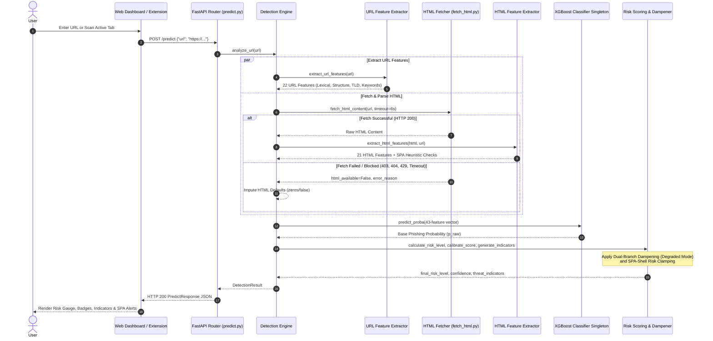

# PhishGuard AI — System Architecture & Design

## 1. Architectural Overview

**PhishGuard AI** is engineered as a decoupled, multi-tiered cybersecurity platform. It provides real-time phishing website detection by synthesizing lexical and structural URL analysis with live server-side HTML DOM inspection.

Both consumer interfaces—the **Web Intelligence Dashboard** and the **Chrome Security Extension**—interact with a centralized **FastAPI Machine Learning Service** over a standardized REST API contract (`POST /predict`).

```
                              ┌────────────────────────┐
                              │     User / Client      │
                              └───────────┬────────────┘
                                          │
                  ┌───────────────────────┴───────────────────────┐
                  ▼                                               ▼
      ┌────────────────────────┐                     ┌────────────────────────┐
      │  React Web Dashboard   │                     │ Chrome MV3 Extension   │
      │    (Vite / Tailwind)   │                     │  (Popup & Worker)      │
      └───────────┬────────────┘                     └────────────┬───────────┘
                  │                                               │
                  └───────────────────────┬───────────────────────┘
                                          │ HTTP POST /predict
                                          ▼
      ┌───────────────────────────────────────────────────────────────────────┐
      │                    FastAPI Backend (REST API Service)                 │
      │                                                                       │
      │  ┌─────────────────────────────────────────────────────────────────┐  │
      │  │                     Prediction Route Handler                    │  │
      │  │                     (app/api/routes/predict.py)                 │  │
      │  └────────────────────────────────┬────────────────────────────────┘  │
      │                                   │                                   │
      │                                   ▼                                   │
      │  ┌─────────────────────────────────────────────────────────────────┐  │
      │  │                     Detection Engine Pipeline                   │  │
      │  │                  (app/services/detection_engine.py)             │  │
      │  └───────┬────────────────────────┬────────────────────────┬───────┘  │
      │          │                        │                        │          │
      │          ▼                        ▼                        ▼          │
      │  ┌───────────────┐        ┌───────────────┐        ┌───────────────┐  │
      │  │  URL Feature  │        │  HTML Fetch & │        │  SPA Shell    │  │
      │  │   Extractor   │        │   DOM Parser  │        │   Detector    │  │
      │  │ (22 Features) │        │ (21 Features) │        │  (Heuristics) │  │
      │  └───────┬───────┘        └───────┬───────┘        └───────┬───────┘  │
      │          │                        │                        │          │
      │          └────────────────┬───────┴────────────────────────┘          │
      │                           ▼                                           │
      │  ┌─────────────────────────────────────────────────────────────────┐  │
      │  │                 Model Loader (Singleton Instance)               │  │
      │  │         (XGBoost Classifier — 43 Ordered Feature Columns)       │  │
      │  └────────────────────────────────┬────────────────────────────────┘  │
      │                                   │ Raw Probabilities                 │
      │                                   ▼                                   │
      │  ┌─────────────────────────────────────────────────────────────────┐  │
      │  │              Risk Scoring & Calibration Engine                  │  │
      │  │    (app/services/risk_scoring.py — Heuristic Adjustments)       │  │
      │  └────────────────────────────────┬────────────────────────────────┘  │
      │                                   │                                   │
      │                                   ▼                                   │
      │  ┌─────────────────────────────────────────────────────────────────┐  │
      │  │                    JSON Response Serializer                     │  │
      │  │              (app/api/schemas/predict_schemas.py)               │  │
      │  └─────────────────────────────────────────────────────────────────┘  │
      └───────────────────────────────────────────────────────────────────────┘
```

---

## 2. End-to-End Execution Flow (Mermaid Sequence)



---

## 3. Directory Structure & Component Responsibilities

The codebase adheres to strict separation of concerns across backend machine learning pipelines, REST services, frontend client applications, and browser extension integrations:

```
s5-phishing-detector/
├── backend/                              # Python 3.10+ / FastAPI Backend
│   ├── app/                              # Application Layer
│   │   ├── main.py                       # FastAPI application setup, CORS, lifespan, middleware
│   │   ├── api/                          # REST API Routers and Schemas
│   │   │   ├── __init__.py
│   │   │   ├── routes/
│   │   │   │   ├── __init__.py
│   │   │   │   └── predict.py            # POST /predict route handler with validation & error handling
│   │   │   └── schemas/
│   │   │       ├── __init__.py
│   │   │       └── predict_schemas.py    # Pydantic v2 request & response validation contracts
│   │   ├── core/                         # Core infrastructure & configuration
│   │   │   ├── __init__.py
│   │   │   ├── config.py                 # Pydantic BaseSettings (.env loader)
│   │   │   └── model_loader.py           # Thread-safe Singleton loader for model & feature schemas
│   │   └── services/                     # Business logic and detection orchestration
│   │       ├── __init__.py
│   │       ├── detection_engine.py       # Orchestrates URL + HTML analysis, model scoring, SPA logic
│   │       └── risk_scoring.py           # Threshold mapping, dampening rules, indicator generation
│   ├── ml/                               # Machine Learning & Data Pipeline
│   │   ├── data_collection/              # Dataset collection & HTML crawling
│   │   │   ├── config.py                 # Source URLs (Tranco, PhishTank, OpenPhish) & fetch settings
│   │   │   ├── fetch_url_lists.py        # Candidate list downloads, normalization & deduplication
│   │   │   ├── fetch_html.py             # Concurrent worker fetching raw HTML with size/timeout caps
│   │   │   ├── crawl_legitimate_deep_links.py # Deep-link crawler mitigating path_length bias
│   │   │   └── build_dataset.py          # Orchestrates full end-to-end dataset creation
│   │   ├── feature_extraction/           # Feature engineering modules
│   │   │   ├── __init__.py
│   │   │   ├── url_features.py           # 22 URL lexical & structural extractors
│   │   │   ├── url_feature_config.py     # Suspicious TLDs, keyword dictionaries, shortener sets
│   │   │   ├── html_features.py          # 21 HTML/DOM extractors (forms, links, JS, iframes)
│   │   │   └── html_feature_config.py    # Login keywords, suspicious JS patterns, SPA thresholds
│   │   ├── models/                       # Production ML Artifacts
│   │   │   ├── phishing_model.joblib     # Serialized XGBoost production classifier
│   │   │   ├── feature_columns.json      # 43 ordered feature names required for inference
│   │   │   └── model_metadata.json       # Hyperparameters, evaluation metrics, and selection rationale
│   │   └── training/                     # Model training & tuning scripts
│   │       ├── build_training_dataset.py # Assembles tabular CSV dataset from raw HTML cache
│   │       ├── train_baseline_models.py  # Baseline training (Random Forest vs XGBoost)
│   │       └── tune_and_finalize_model.py # GridSearchCV tuning, class weighting, persistence
│   ├── data/                             # Data directory (Raw & Processed datasets)
│   ├── tests/                            # Comprehensive Pytest test suite (80+ unit/integration tests)
│   ├── requirements.txt                  # Python production dependencies
│   └── .env.example                      # Backend environment variable template
├── frontend/                             # React Web Dashboard (Stage 10)
│   ├── src/
│   │   ├── main.jsx                      # React entrypoint
│   │   ├── App.jsx                       # Root application view
│   │   ├── index.css                     # Tailwind CSS directives & custom design tokens
│   │   ├── api/                          # Client API services (Axios/Fetch wrapper)
│   │   │   └── client.js                 # POST /predict request wrapper with error handling
│   │   ├── components/                   # Modular UI components
│   │   │   ├── Header.jsx                # Navigation & system status bar
│   │   │   ├── Footer.jsx                # Academic attribution & disclaimer
│   │   │   ├── ScanInput.jsx             # URL text input, preset sample chips, validation guards
│   │   │   ├── ScanningState.jsx         # Animated multi-stage analysis progress indicator
│   │   │   ├── ResultCard.jsx            # Radial score gauge, status badge, SPA warning alerts
│   │   │   ├── RiskBadge.jsx             # Color-coded threat level badge (Safe, Low, Medium, High)
│   │   │   ├── IndicatorsList.jsx        # Categorized indicator cards (URL vs HTML observations)
│   │   │   ├── UrlFeaturesSummary.jsx    # Key lexical attribute pills (HTTPS, Length, TLD)
│   │   │   ├── ScanHistory.jsx           # Session scan history table with quick reload
│   │   │   └── ErrorState.jsx            # Error boundary & retry prompt
│   │   ├── hooks/
│   │   │   └── useScan.js                # State machine hook with cancellation & inFlight guards
│   │   └── pages/
│   │       └── Dashboard.jsx             # Main dashboard layout
│   ├── package.json                      # Node dependencies (React 18, Vite 5, Tailwind CSS)
│   └── vite.config.js                    # Vite bundler configuration & local dev server proxy
├── extension/                            # Google Chrome Extension MV3 (Stage 11)
│   ├── manifest.json                     # Chrome Extension Manifest V3 configuration
│   ├── background/
│   │   └── service-worker.js             # Non-persistent background service worker
│   ├── popup/
│   │   ├── popup.html                    # Extension popup user interface markup
│   │   ├── popup.css                     # Dark-mode extension styles, badge animations
│   │   └── popup.js                      # Active tab retrieval, API dispatch, monotonic scanId sequencing
│   └── icons/                            # Extension toolbar icons (16px, 48px, 128px)
├── docs/                                 # Technical Documentation (Stage 14)
└── README.md                             # Top-level repository overview
```

---

## 4. Shared API Contract (`POST /predict`)

Both the Web Dashboard and Chrome Extension communicate with the backend through the exact same schema contract:

### Request Body (`PredictRequest`)
```json
{
  "url": "https://secure-login.bank-update.xyz/verify/account"
}
```

### Response Body (`PredictResponse`)
```json
{
  "url": "https://secure-login.bank-update.xyz/verify/account",
  "is_phishing": true,
  "risk_level": "high",
  "confidence": 0.9854,
  "html_available": true,
  "content_rendering_incomplete": false,
  "indicators": [
    "Domain utilizes a high-risk or commonly abused top-level domain (TLD).",
    "URL contains sensitive or authentication-related keywords (e.g., login, verify, account, secure).",
    "Form submission sends sensitive user data to an external third-party domain.",
    "Page contains an authentication or login form requesting user credentials."
  ],
  "features": {
    "url_features": {
      "url_length": 59,
      "domain_length": 34,
      "path_length": 15,
      "uses_https": true,
      "has_suspicious_tld": true,
      "has_suspicious_keywords": true,
      "is_shortened_url": false
    },
    "html_features": {
      "has_login_form": true,
      "num_password_fields": 1,
      "num_links": 4,
      "external_link_ratio": 0.75,
      "has_suspicious_js_patterns": false
    }
  },
  "scan_duration_ms": 312.45
}
```
